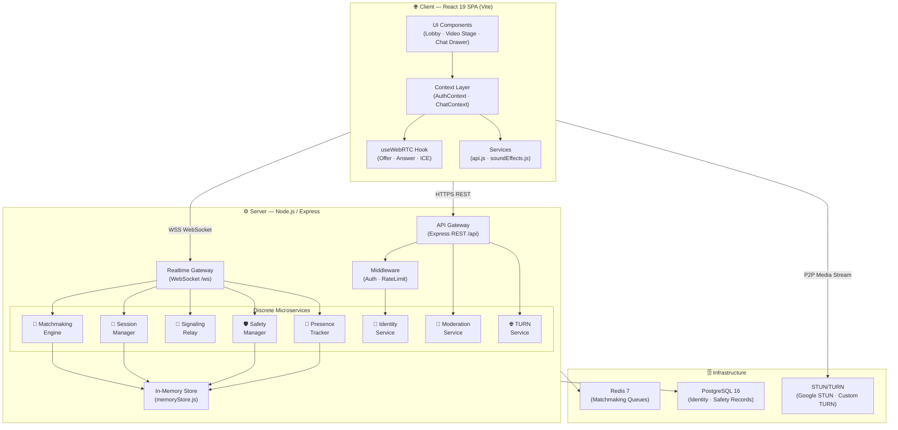
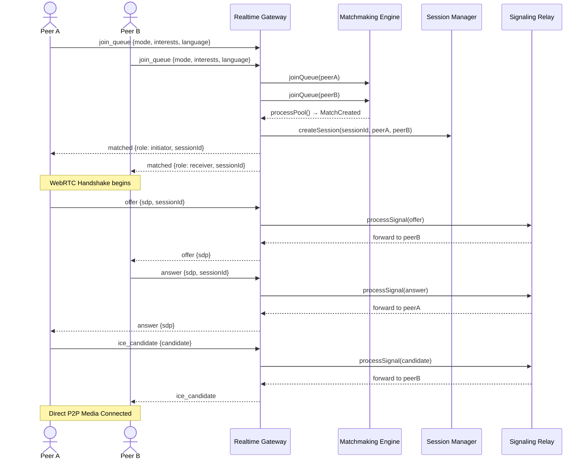

<div align="center">

# 🎥 O P Omegle (P-Omegle)

<p align="center">
  <strong>Next-Generation, Privacy-First, Open-Source Random Video & Anonymous Text Chat</strong><br/>
  <em>Engineered with Pure P2P WebRTC · React 19 · Node.js · Express · WebSockets · Handcrafted Vector Doodles</em>
</p>

<p align="center">
  <a href="https://github.com/Mausam5055/P-Omegle/releases"></a>
  <a href="https://opensource.org/licenses/MIT"></a>
  <a href="https://react.dev/"></a>
  <a href="https://nodejs.org/"></a>
  <a href="https://vitejs.dev/"></a>
  <a href="https://webrtc.org/"></a>
  <a href="https://web.dev/progressive-web-apps/"></a>
  <a href="https://github.com/Mausam5055/P-Omegle/actions"></a>
</p>

<p align="center">
  <a href="#-overview">Overview</a> •
  <a href="#-key-features">Key Features</a> •
  <a href="#-architecture">Architecture</a> •
  <a href="#-tech-stack">Tech Stack</a> •
  <a href="#-folder-structure">Folder Structure</a> •
  <a href="#-getting-started">Getting Started</a> •
  <a href="#-websocket-events">WebSocket Events</a> •
  <a href="#-production--deployment">Deployment</a> •
  <a href="#-security--privacy">Security</a> •
  <a href="#-license">License</a>
</p>

</div>

---

## 📖 Overview

**O P Omegle** is a modern, high-performance web platform that pairs two strangers in real-time encrypted video and text conversations without intermediaries, data harvesting, or mandatory registrations.

Re-engineered from first principles to overcome the legacy architectural flaws of early-2000s chat platforms, O P Omegle combines **pure Peer-to-Peer WebRTC media streaming**, an **asynchronous WebSocket matchmaking gateway**, and a **clean handcrafted doodle aesthetic** inspired by minimalist Open Peeps illustrations.

### 💡 Why O P Omegle?

| Legacy Chat Platforms (e.g., Old Omegle) | O P Omegle Solution |
|:---|:---|
| ❌ Centralized media servers (high latency, costly bandwidth) | ✅ **True P2P Media**: Video and audio stream directly between peer browsers |
| ❌ Immediate call drops on minor network packet jitter | ✅ **15-Second Grace Window**: Automatically restores session on brief disconnects |
| ❌ Zero common-ground matching (purely random) | ✅ **Interest-Based Tag Filtering**: Connect by shared passions (`#tech`, `#design`, etc.) |
| ❌ Primitive UI with distracting, clunky layouts | ✅ **Handcrafted Doodle Aesthetic**: Crisp ink boundaries, zero AI-slop gradients |
| ❌ No in-call multitasking | ✅ **Non-Intrusive Chat Drawer**: In-call text messages without obscuring the live stream |
| ❌ Cluttered with paywalls and forced "Pro" upsells | ✅ **100% Free & Open**: Zero paywalls, zero locked tiers, zero trackers |

---

## ✨ Key Features

### 🎥 Live Video & WebRTC Media
- **Direct P2P Video & Audio**: Ultra-low latency camera and microphone streaming via browser-native WebRTC.
- **Hardware Camera Flipping**: One-tap toggle between user-facing selfie camera and environment-facing rear lens on mobile devices.
- **Smart Autoplay Fallback**: Automatically recovers from strict browser autoplay policies with seamless gesture listeners.
- **Dual Responsive Grid**: Side-by-side viewfinder on desktop; stacked single-plane views on mobile with zero clumsy borders or dark overlaps.

### 💬 In-Call Realtime Chat Drawer
- **Docked Sliding Drawer**: Real-time text messaging alongside the live video call without viewport disruption.
- **Live Connection Telemetry**: Real-time status indicators (`Connected live` with green pulse, `Connecting...`, `Stranger disconnected`, or `User not connected`).
- **Emoji Palette & Typing Indicators**: Integrated emoji keyboard and live `stranger is typing...` status.
- **Unread Message Notifications**: Vibrantly animated green pulse badge in the navbar and floating incoming message preview banners with quick-reply.

### 🎨 Handcrafted Doodle Design System
- **5 Distinct Vector Doodle Avatars**: Choose between Beanie, Glasses, Snapback Cap, Fluffy Afro, and DJ Headphones — razor-sharp vector SVGs that scale cleanly without pixelation.
- **Subtle Texture Overlays**: Hand-drawn doodle pattern backgrounds applied with subtle blur for maximum readability.
- **Instant Navbar & Profile Sync**: Local profile updates instantly synchronize across the navbar, lobby, and session state without page reloads.

### 📱 Progressive Web App (PWA)
- **Installable Native App Experience**: Includes full Web App Manifest and offline caching Service Worker (`sw.js`).
- **PWA Floating Install Banner**: Native install prompt for Chrome, Edge, and iOS Safari ("Add to Home Screen").

---

## 🏗️ Architecture

### High-Level System Overview



---

### Matchmaking & Session Lifecycle



---

## 💻 Tech Stack

### Frontend Architecture
| Layer | Technology | Description |
|:---|:---|:---|
| **Framework** |  | Latest React 19 functional architecture with custom hooks |
| **Build Tool** |  | Blazing-fast development server & optimized ESM production bundling |
| **Styling** |  | Tailored Neo-Brutalist clean design system, variables, and responsive media rules |
| **Icons** |  | Lightweight, razor-sharp icon set |
| **Vector Graphics** |  | 100% self-contained pure SVG doodle characters with zero HTTP asset overhead |
| **Audio Synthesis** |  | Synthesized audio tones for chimes, pops, and match notifications |
| **Mobile App** |  | Standalone mobile installability with background cache |

### Backend Architecture
| Layer | Technology | Description |
|:---|:---|:---|
| **Runtime** |  | High-performance asynchronous JavaScript server runtime |
| **Web Server** |  | RESTful API gateway handling auth, presence telemetry, and reports |
| **Realtime Gateway** |  | Low-latency WebRTC signaling, queues, and chat routing |
| **Signaling & Relay** |  | Session Description Protocol (SDP) and ICE candidate forwarder |
| **Security & Auth** |  | JSON Web Tokens with refresh-token rotation and Bcrypt password hashing |
| **Persistence (Optional)** |   | Distributed queuing and persistent data stores with in-memory fallbacks |

---

## 📁 Folder Structure

```
P-Omegle/
├── client/                     # Frontend Application (React 19 + Vite)
│   ├── public/
│   │   ├── chat-doodle-bg.jpg  # Subtle repeat background texture
│   │   ├── favicon.svg         # Handcrafted doodle camera brand favicon
│   │   ├── manifest.json       # Progressive Web App manifest
│   │   └── sw.js               # Service Worker for PWA caching
│   ├── src/
│   │   ├── components/
│   │   │   ├── chat/           # InCallChatDrawer & EmojiPicker
│   │   │   ├── doodles/        # DoodleCharacter.jsx (Avatar heads & logo SVGs)
│   │   │   ├── layout/         # Top Navbar with live unread indicators
│   │   │   ├── lobby/          # LobbyScreen (Camera viewfinder & matching setup)
│   │   │   ├── modals/         # UserProfileModal & DeviceSettingsModal
│   │   │   ├── pwa/            # InstallPwaPrompt banner
│   │   │   └── video/          # LiveVideoStage (WebRTC dual streams)
│   │   ├── context/            # AuthContext.jsx & ChatContext.jsx
│   │   ├── hooks/              # useWebRTC.js (Signaling & peer connection lifecycle)
│   │   ├── services/           # api.js & soundEffects.js
│   │   └── styles/             # index.css (Unified Neo-Brutalist Design System)
│   └── index.html              # HTML5 entry with PWA headers & SEO metadata
│
├── server/                     # Backend Application (Node.js + Express + WS)
│   ├── config/                 # env.js configuration loader
│   ├── middleware/             # auth.js, rateLimiter.js
│   ├── models/                 # User.js, Report.js, Session.js
│   ├── routes/                 # auth.js, match.js, moderation.js
│   ├── services/               # Microservices
│   │   ├── identityService.js  # Account authentication & guest tokens
│   │   ├── matchmakingEngine.js# Weighted interest matchmaking queue
│   │   ├── sessionManager.js   # Room lifecycle & 15s grace period restore
│   │   ├── signalingRelay.js   # WebRTC SDP/ICE candidate forwarder
│   │   └── safetyManager.js    # Per-IP rate limiting, reporting, and bans
│   └── server.js               # Express app & WebSocket server initialization
│
├── docker-compose.yml          # Multi-container orchestration (App, Redis, Postgres)
├── package.json                # Monorepo root scripts
└── README.md                   # Project documentation
```

---

## 🚀 Getting Started

### Prerequisites
- **Node.js**: `v18.0.0` or higher (Node 20+ or 24 LTS recommended)
- **npm**: `v9.0.0` or higher
- Modern Web Browser with camera/microphone access (Chrome, Edge, Firefox, Safari)

### Quickstart Installation

1. **Clone the repository:**
   ```bash
   git clone https://github.com/Mausam5055/P-Omegle.git
   cd P-Omegle
   ```

2. **Install all dependencies:**
   ```bash
   npm run install:all
   ```

3. **Start Development Servers:**
   ```bash
   npm run dev
   ```
   *Starts backend on port `5000` and Vite client on port `5173` concurrently.*

4. **Open in your browser:**
   ```
   http://localhost:5173
   ```
   *Tip: Open a secondary incognito window to simulate two peers and test real-time P2P matching instantly!*

---

## 📡 WebSocket Event Contracts

The Realtime Gateway communicates bidirectionally over `ws://localhost:5000/ws`:

| Action / Event | Direction | Payload Example | Description |
|:---|:---:|:---|:---|
| `join_queue` | Client ➔ Server | `{ "mode": "video", "interests": ["tech"] }` | Enters matchmaking pool |
| `queued` | Server ➔ Client | `{ "status": "searching" }` | Confirms client is queued |
| `matched` | Server ➔ Client | `{ "sessionId": "uuid", "role": "initiator" }` | Signals successful pair |
| `offer` / `answer` | Client ⇄ Server | `{ "sdp": "...", "sessionId": "uuid" }` | WebRTC session negotiation |
| `ice_candidate` | Client ⇄ Server | `{ "candidate": "...", "sessionId": "uuid" }` | P2P network traversal candidate |
| `chat_message` | Client ⇄ Server | `{ "payload": { "text": "Hello!" } }` | Live ephemeral text chat |
| `typing_status` | Client ⇄ Server | `{ "payload": { "isTyping": true } }` | Updates typing state |
| `partner_left` | Server ➔ Client | `{ "reason": "Stranger left conversation." }` | Signals partner disconnection |
| `heartbeat` | Client ➔ Server | `{ "payload": { "sessionId": "uuid" } }` | 15s keep-alive ping |

---

## 📦 Extended Technical Documentation

Click each section below to expand detailed documentation:

<details>
<summary><b>🛡️ Security, Privacy & Compliance</b></summary>
<br/>

### Data Privacy Principles
- **Ephemeral Media Streams**: Video and audio data are strictly peer-to-peer. No video packets are ever routed through, stored, or processed on the server.
- **P2P Encryption**: Built on WebRTC standard DTLS (Datagram Transport Layer Security) and SRTP (Secure Real-time Transport Protocol).
- **Ephemeral Text Messages**: Chat messages exist only in client memory during the call. They are completely flushed upon skipping or ending the session.
- **Zero Tracker Footprint**: No third-party ad pixels, analytics trackers, or social sharing SDKs.

### Responsible Disclosure
If you find a security vulnerability, please submit it via [GitHub Security Advisories](https://github.com/Mausam5055/P-Omegle/security/advisories/new) rather than opening a public issue. Critical disclosures receive response and remediation within 48 hours.

</details>

<details>
<summary><b>🐳 Docker & Production Deployment</b></summary>
<br/>

### Running with Docker Compose
The project includes a ready-to-use Docker configuration including backend, frontend reverse proxy, Redis, and PostgreSQL:

```bash
# Build and launch the containerized cluster
docker-compose up --build -d

# Check cluster logs
docker-compose logs -f
```

### Production Checklist
1. **SSL Termination**: Always host over HTTPS and WSS (WebRTC requires a secure context to access camera and microphone).
2. **STUN/TURN Configuration**: Supply production TURN credentials in `.env` (`TURN_SERVER_URL`, `TURN_USERNAME`, `TURN_CREDENTIAL`) to guarantee connections behind restrictive corporate firewalls and symmetric NATs.
3. **CORS Whitelist**: Restrict `ALLOWED_ORIGINS` to your production domain.

</details>

<details>
<summary><b>⚙️ Environment Variables Reference</b></summary>
<br/>

Create a `.env` file in the `server/` directory:

| Variable | Default | Description |
|:---|:---|:---|
| `PORT` | `5000` | Port for the Express REST and WebSocket server |
| `NODE_ENV` | `development` | Runtime mode (`development` or `production`) |
| `JWT_SECRET` | `omegle-insecure-dev-secret` | 256-bit secret used to sign JWT access tokens |
| `REFRESH_TOKEN_SECRET` | `omegle-insecure-refresh-secret`| Secret used to sign long-lived refresh tokens |
| `ALLOWED_ORIGINS` | `http://localhost:5173` | Comma-separated list of allowed CORS domains |
| `REDIS_URL` | *empty (in-memory)* | Optional Redis connection string for multi-server clustering |
| `DATABASE_URL` | *empty (in-memory)* | Optional PostgreSQL connection string |
| `TURN_SERVER_URL` | *empty* | Optional custom coturn or Twilio TURN server URL |

</details>

<details>
<summary><b>🤝 Contributing Guidelines</b></summary>
<br/>

Contributions are welcome! Please follow these standards:

1. **Fork the Repository** and create a feature branch (`git checkout -b feat/my-new-feature`).
2. **Adhere to Code Guidelines**:
   - Use ES Modules (`import`/`export`) exclusively.
   - Maintain clean CSS tokens and the black-ink doodle design language.
   - Run `npm run build` in `client` before committing to ensure zero compilation or bundling errors.
3. **Commit using Conventional Commits** (`feat:`, `fix:`, `docs:`, `perf:`).
4. **Submit a Pull Request** describing your changes and testing evidence.

</details>

<details>
<summary><b>📄 MIT License</b></summary>
<br/>

```
MIT License

Copyright (c) 2026 O P Omegle Team

Permission is hereby granted, free of charge, to any person obtaining a copy
of this software and associated documentation files (the "Software"), to deal
in the Software without restriction, including without limitation the rights
to use, copy, modify, merge, publish, distribute, sublicense, and/or sell
copies of the Software, and to permit persons to whom the Software is
furnished to do so, subject to the following conditions:

The above copyright notice and this permission notice shall be included in all
copies or substantial portions of the Software.

THE SOFTWARE IS PROVIDED "AS IS", WITHOUT WARRANTY OF ANY KIND, EXPRESS OR
IMPLIED, INCLUDING BUT NOT LIMITED TO THE WARRANTIES OF MERCHANTABILITY,
FITNESS FOR A PARTICULAR PURPOSE AND NONINFRINGEMENT. IN NO EVENT SHALL THE
AUTHORS OR COPYRIGHT HOLDERS BE LIABLE FOR ANY CLAIM, DAMAGES OR OTHER
LIABILITY, WHETHER IN AN ACTION OF CONTRACT, TORT OR OTHERWISE, ARISING FROM,
OUT OF OR IN CONNECTION WITH THE SOFTWARE OR THE USE OR OTHER DEALINGS IN THE
SOFTWARE.
```

</details>

---

<div align="center">

**Built with ❤️ for privacy, open connectivity, and playful design.**

<p>
  <a href="https://github.com/Mausam5055/P-Omegle/issues">🐛 Report Bug</a> •
  <a href="https://github.com/Mausam5055/P-Omegle/issues">💡 Request Feature</a> •
  <a href="https://github.com/Mausam5055/P-Omegle/discussions">💬 Discussions</a>
</p>

</div>
